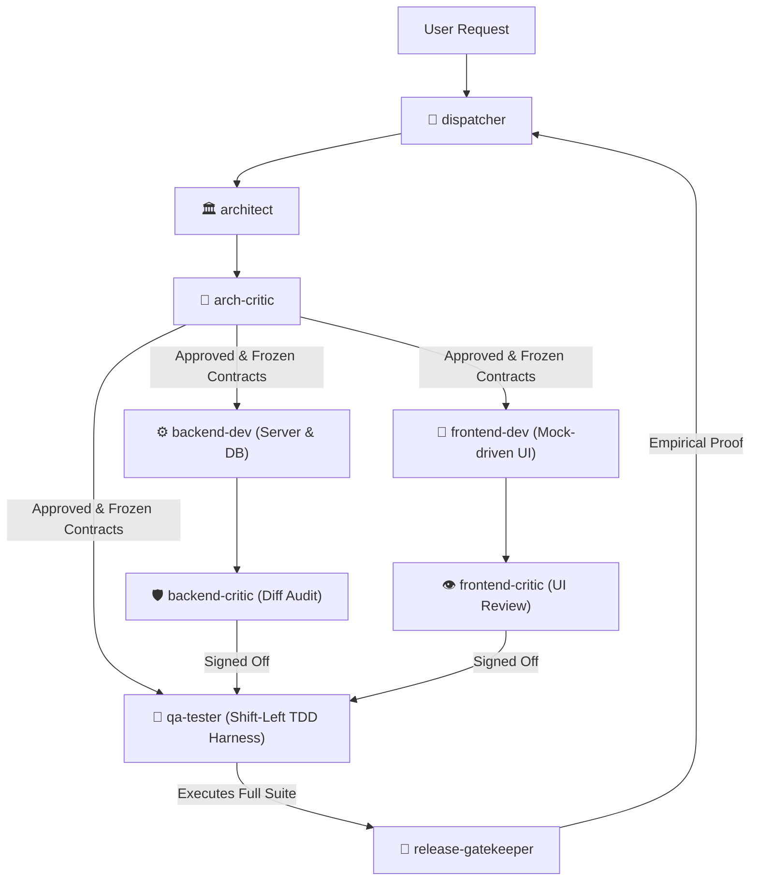

# Autonomous Software Company (Hybrid Engineering Harness)

An enterprise-grade **Hybrid Autonomous Engineering Harness** combining **lean specialist agents** (4 Builder-Critic tracks + Task Dispatcher + on-demand Stall Monitor) with a deterministic, zero-dependency Node.js CLI runtime ([`scripts/swarm-cli.cjs`](scripts/swarm-cli.cjs)).

All model tiers, provider adapters, non-null fallbacks, risk policies, timeouts, and execution settings are centrally governed by [`config/swarm.config.yaml`](config/swarm.config.yaml).

---

## 1. Squad Roster & Visual Identity

The team operates as a **10-agent adaptive squad (4 Builder-Critic tracks + Dispatcher + on-demand Monitor)**:

| Track | Icon | Agent Name | Technical Role | Core Responsibility | Workspace |
|---|:---:|---|---|---|:---:|
| **Orchestration** | 🎯 | `dispatcher` | Task Dispatcher | Requirement breakdown, adaptive mode routing, deterministic CLI leases | `inherit` |
| **Architecture** | 🏛️ | `architect` | Lead Architect | System design, domain modeling, contract specifications with mocks | `inherit` |
| | 🧐 | `arch-critic` | Architecture Critic | Structural review, anti-pattern detection, contract freeze sign-off | `inherit` |
| **Backend** | ⚙️ | `backend-dev` | Backend Engineer | APIs, database migrations, server logic, endpoints | `share` |
| | 🛡️ | `backend-critic` | Backend Critic | Diff-scoped security audits (`security-audit`), OWASP Top 10, SQL optimization | `inherit` |
| **Frontend** | 🎨 | `frontend-dev` | Frontend Engineer | Responsive interfaces (360px+), accessible components, mock-driven UI | `share` |
| | 👁️ | `frontend-critic` | Frontend Critic | Interface auditing (`better-interface`), 360px viewport audit, WCAG 2.1 AA | `inherit` |
| **Quality & Release** | 🧪 | `qa-tester` | QA Automation | Shift-left TDD, deterministic test harnesses, full suite execution | `inherit` |
| | 🚀 | `release-gatekeeper` | Release Gatekeeper | Build integrity, empirical test verification, release sign-off | `inherit` |
| **Safety Net** | 📡 | `monitor` | Stall Monitor | On-demand stall recovery invoked when `swarm-cli.cjs check-stalls` exits `2` | `inherit` |

### Backward Compatibility & Supported Trigger Phrases
The skill directory [`skills/four-agent-swarm/`](skills/four-agent-swarm/SKILL.md) acts as the unified backward-compatible entry point and alias for the complete 10-agent adaptive squad. Supported trigger phrases include:
- `شغل 4 ايجنت`
- `شغل 9 ايجنت`
- `شغل الفريق`
- `شغل الشركة البرمجية`
- `swarm team`
- `/swarm` *(runtime slash-command alias support)*

---

## 2. Adaptive Execution Modes

The Dispatcher evaluates 8 task factors (complexity, affected modules, security impact, database impact, frontend/backend involvement, architectural novelty, required verification, and estimated duration) and routes to the smallest safe execution mode:

- **Quick Mode (2–3 agents, `tier_0` default):** Localized changes ($\le 2$ files), minor UI/CSS tweaks, docs. `Dispatcher -> <relevant-dev> (backend-dev | frontend-dev) -> Self-Verification` (+ lightweight Critic if escalated to `tier_1`, or QA if test-heavy).
- **Standard Mode (5–6 agents, `tier_1` default):** Regular features, database-backed endpoints, moderate refactors. `Dispatcher -> Architecture (when needed) -> Parallel Devs -> dynamic_critic (backend-critic | frontend-critic by changed paths) -> QA -> Release Gatekeeper`.
- **Enterprise Mode (9 working agents + on-demand Monitor = 10 agents):** Platform-wide features, new system architectures, critical authentication or database migrations. Full squad engagement.

> [!IMPORTANT]
> **Execution Mode and Risk Tier are independent decisions.** For example, a 3-line authentication fix runs in Quick Mode with Tier 2 review; a 50-page documentation update runs with Tier 0 review. Never downgrade Risk Tier because implementation size is small.

---

## 3. Risk-Tiered Review Protocol

Risk tiers govern reviewer depth and time budgets, recorded deterministically via `scripts/swarm-cli.cjs` in `.swarm/state.json`:

- **Tier 0 (Fast Lane — 5m budget):** Documentation, comments, copy, pure CSS spacing/colors, non-security config. No critic required; author self-verifies and submits `git diff` evidence.
- **Tier 1 (Standard Review — 15m budget):** Regular features, routine APIs, isolated components. Diff-scoped single-pass review by `dynamic_critic`; targeted tests; no full codebase rescan.
- **Tier 2 (Deep Review — 25m budget):** Authentication, sessions, payments, database migrations, security rules, user data, input parsing, secrets. Strongest configured tier + independent security verification + regression/integration tests + explicit approval before handoff.
- Critics may escalate a tier upward based on discovered risks, but can **never silently downgrade it**.

---

## 4. Parallel Streamed Execution & Contract Freeze



1. **Contract Freeze:** As soon as architecture contracts are approved by `arch-critic`, contracts are frozen and `backend-dev`, `frontend-dev` (building against mocks), and `qa-tester` (drafting deterministic harnesses) run concurrently.
2. **Reopening Contracts:** Reopening a frozen contract requires a formal Dispatcher decision card specifying affected interfaces, rationale, and mock/test updates.
3. **Right-Sized Tasks:** Maximum 5 touched files per task unit (enforced by `swarm-cli.cjs lock acquire`); target duration $\le 15$ minutes. At 80% budget emit a 1-line status update; at 100% stop extending and report blockers.
4. **Review Caps:** Maximum 2 review rounds per task. After Round 2, the critic must approve or escalate one consolidated decision to Dispatcher.

---

## 5. Lazy-Loaded Skills Architecture (40 Skills, Zero Orphans)

To maintain prompt hygiene and eliminate redundant context:
- **40 standardized `kebab-case` skills** (`39` wired in `config/swarm.config.yaml` + `skills/four-agent-swarm` unified entrypoint; enforced by the Orphan Skill Guard in `scripts/smoke-test.sh`).
- Core `SKILL.md` files are strictly bounded ($\le 80$ lines for new skills, $\le 120$ lines for split skills), with deep references consolidated under `skills/<skill-name>/references/*.md`.
- Agents preload a maximum of 3 core skills, loading `references/*.md` (and `skills_on_demand` such as `audit-reporting`, `architecture-decision-records`, `unit-testing-test-generate`, `github-actions-templates`) only when actively needed.

---

## 6. Logical Model Tiers & Non-Null Fallback Policy

Model routing is governed centrally in [`config/swarm.config.yaml`](config/swarm.config.yaml):
- **Logical Tiers (`reasoning_tier`, `builder_tier`, `fast_tier`):** Agents reference logical tiers (`model_tier`) instead of duplicated provider strings.
- **Provider Adapters & Non-Null Fallbacks:** `provider_adapters` maps every logical tier across supported hosts (`antigravity`, `claude-code`, `cursor`, `gemini-cli`), and `models.fallback_map` guarantees a non-null fallback chain for every tier.

---

## 7. Project Context Memory

Squad agents read local project memory initialized by `scripts/swarm-cli.cjs init`:
- Stored locally in `.swarm/project-context.md` (gitignored).
- Canonical template maintained in [`config/project-context.template.md`](config/project-context.template.md).
- Enforces 13 architectural sections, verified Git commit hash (`git rev-parse HEAD`), and zero secret exposure.

---

## 8. Deterministic Runtime CLI & File Ownership

Concurrency safety, metrics, and stall detection are enforced deterministically via [`scripts/swarm-cli.cjs`](scripts/swarm-cli.cjs) (zero external dependencies):
- **Initialize Runtime:** `node scripts/swarm-cli.cjs init` creates `.swarm/state.json`, `.swarm/project-context.md`, `.swarm/metrics.jsonl`, and `.swarm/followups.md`.
- **Atomic File Leases:** `lock acquire`, `lock check`, and `lock release` enforce single active writer per file, reject path traversal/`..`, enforce `max_files_per_task: 5`, and write `.swarm/state.json` atomically via `.swarm/state.json.tmp`.
- **Structured Telemetry:** `log-metric` appends validated `agent_run`, `task_summary`, and `stall` JSONL records compatible with [`scripts/swarm-report.sh`](scripts/swarm-report.sh).
- **Deterministic Stall Checks:** `check-stalls` returns exit code `0` when healthy or exit code `2` with `{ warn, escalate }` JSON when tasks stall ($\ge 3$m / $\ge 5$m), waking `@monitor` strictly on demand.

---

## 9. Quickstart & Installation

Install skills, recursive `rules/` (`rules/references/*`), `agents/`, `config/`, and `scripts/` into your local environment (`~/.gemini/config/` or `$SWARM_TARGET_DIR`):

### Windows Installation (PowerShell)
```powershell
# Install and verify required target files
powershell -ExecutionPolicy Bypass -File .\install.ps1 -Verify

# Dry-run inspection (no files written)
powershell -ExecutionPolicy Bypass -File .\install.ps1 -DryRun
```

### macOS / Linux Installation (Bash)
```bash
# Install and verify required target files
chmod +x ./install.sh
./install.sh --verify

# Dry-run inspection (no files written)
./install.sh --dry-run
```

---

## 10. Verification, CI, Benchmarks & Audit Proof

### Full Test Suite (`npm test`)
Runs smoke checks (skills, agents, links, zero orphans, installer parity, fixtures), audit-report schema tests, and deterministic runtime CLI tests:
```bash
npm test
```

Individual suites:
```bash
npm run test:smoke    # bash scripts/smoke-test.sh
npm run test:report   # node scripts/verify-report.test.cjs
npm run test:cli      # node --test scripts/swarm-cli.test.cjs
node --test skills/security-audit/*.test.cjs
```

### Verified End-to-End Example Proof
Inspect the verified benchmark and audit fixture under [`examples/sample-benchmark/`](examples/sample-benchmark/):
- [`examples/sample-benchmark/metrics.jsonl`](examples/sample-benchmark/metrics.jsonl) — Complete `standard`-mode run emitted via `scripts/swarm-cli.cjs log-metric`
- [`examples/sample-benchmark/swarm-report-output.txt`](examples/sample-benchmark/swarm-report-output.txt) — Captured output from `bash scripts/swarm-report.sh examples/sample-benchmark/metrics.jsonl`
- [`examples/sample-benchmark/audit-report.md`](examples/sample-benchmark/audit-report.md) — Verified sample audit report passing `node scripts/verify-report.cjs examples/sample-benchmark/audit-report.md` (exit code `0`)

---

## 11. Security & Zero Secret Leakage Policy

This repository enforces strict protection standards:
- Comprehensive `.gitignore` protecting `.swarm/`, `.env` variations, certificate files, tokens, and local database artifacts.
- Zero secrets committed: runtime inputs and audit reports validated via zero-dependency schemas (`scripts/verify-report.cjs`, `scripts/swarm-cli.cjs`, `skills/security-audit/validate-findings.cjs`).
