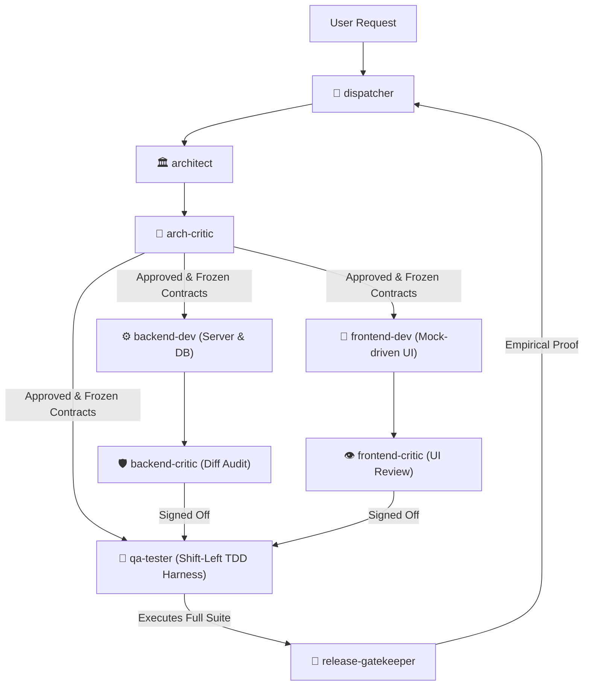

# Autonomous Software Company (10-Agent Engineering Squad)

An enterprise-grade autonomous software development system designed for AI coding environments. It structures development into **4 Builder-Critic tracks** coordinated by a **Task Dispatcher** and safeguarded by a **Stall Monitor**, pairing each implementing author with a dedicated adversarial reviewer to ensure zero-defect delivery.

All model configurations, fallbacks, risk policies, timeouts, and execution settings are centrally governed by [`config/swarm.config.yaml`](config/swarm.config.yaml).

---

## 1. Squad Roster & Visual Identity

The team operates as a **10-agent squad (4 Builder-Critic tracks + Dispatcher + Monitor)**:

| Track | Icon | Agent Name | Technical Role | Core Responsibility | Workspace |
|---|:---:|---|---|---|:---:|
| **Orchestration** | 🎯 | `dispatcher` | Task Dispatcher | Requirement breakdown, adaptive mode routing, file lease management | `inherit` |
| **Architecture** | 🏛️ | `architect` | Lead Architect | System design, domain modeling, contract specifications with mocks | `inherit` |
| | 🧐 | `arch-critic` | Architecture Critic | Structural review, anti-pattern detection, contract freeze sign-off | `inherit` |
| **Backend** | ⚙️ | `backend-dev` | Backend Engineer | APIs, database migrations, server logic, endpoints | `share` |
| | 🛡️ | `backend-critic` | Backend Critic | Security audits (`security-audit`), OWASP Top 10, SQL query optimization | `inherit` |
| **Frontend** | 🎨 | `frontend-dev` | Frontend Engineer | Responsive interfaces (360px+), accessible components, mock-driven UI | `share` |
| | 👁️ | `frontend-critic` | Frontend Critic | Interface auditing (`better-interface`), 360px viewport audit, WCAG 2.1 AA | `inherit` |
| **Quality & Release** | 🧪 | `qa-tester` | QA Automation | Shift-left TDD, deterministic test harnesses, full suite execution | `inherit` |
| | 🚀 | `release-gatekeeper` | Release Gatekeeper | Build integrity, empirical test verification, release sign-off | `inherit` |
| **Safety Net** | 📡 | `monitor` | Stall Monitor | Activity tracking, 3-minute stall pings, deadlock escalation | `inherit` |

### Backward Compatibility & Supported Trigger Phrases
The skill directory [`skills/four-agent-swarm/`](skills/four-agent-swarm/SKILL.md) acts as the backward-compatible entry point and alias for the complete 10-agent adaptive squad. Supported trigger phrases include:
- `شغل 4 ايجنت`
- `شغل 9 ايجنت`
- `شغل الفريق`
- `شغل الشركة البرمجية`
- `swarm team`
- `/swarm` *(runtime slash-command alias support)*

---

## 2. Adaptive Execution Modes

The Dispatcher evaluates 8 task factors (complexity, affected modules, security impact, database impact, frontend/backend involvement, architectural novelty, required verification, and estimated duration) and routes to the smallest safe execution mode:

- **Quick Mode (2–3 agents):** Small bug fixes, localized UI/CSS changes, docs, formatting. `Dispatcher -> Relevant Dev -> Self-Verification` (+ lightweight Critic if Tier 1, or QA if test-heavy; no Architect unless structural design is needed).
- **Standard Mode (4–5 agents):** Normal features, database-backed endpoints, moderate refactors. `Dispatcher -> Relevant Planning -> Parallel Devs -> Relevant Critic(s) -> QA -> Release Gatekeeper`.
- **Enterprise Mode (9 working agents + 1 Monitor = 10 agents):** Platform-wide features, new system architectures, critical authentication or database migrations. Full squad engagement.

> [!IMPORTANT]
> **Execution Mode and Risk Tier are independent decisions.** For example, a 3-line authentication fix runs in Quick Mode with Tier 2 review; a 50-page documentation update runs with Tier 0 review. Never downgrade Risk Tier because implementation size is small.

---

## 3. Risk-Tiered Review Protocol

Risk tiers govern reviewer depth and time budgets, stored by Dispatcher in `.swarm/state.json`:

- **Tier 0 (Fast Lane — 5m budget):** Documentation, comments, copy, pure CSS spacing/colors, non-security config. No critic required; author self-verifies and submits `git diff` evidence.
- **Tier 1 (Standard Review — 15m budget):** Regular features, routine APIs, isolated components. Diff-scoped single-pass review by 1 lightweight critic per domain; targeted tests; no full codebase rescan.
- **Tier 2 (Deep Review — 25m budget):** Authentication, sessions, payments, database migrations, security rules, user data, input parsing, secrets. Strongest configured critic + independent security verification + regression/integration tests + explicit approval before handoff.
- Critics may escalate a tier upward based on discovered risks, but can **never silently downgrade it**.

---

## 4. Parallel Streamed Execution & Contract Freeze



1. **Contract Freeze:** As soon as architecture contracts are approved by `arch-critic`, contracts are frozen and `backend-dev`, `frontend-dev` (building against mocks), and `qa-tester` (drafting deterministic harnesses) run concurrently.
2. **Reopening Contracts:** Reopening a frozen contract requires a formal Dispatcher decision card specifying affected interfaces, rationale, and mock/test updates.
3. **Right-Sized Tasks:** Maximum 5 touched files per task unit; target duration $\le 15$ minutes. At 80% budget emit a 1-line status update; at 100% stop extending and report blockers.
4. **Review Caps:** Maximum 2 review rounds per task. After Round 2, the critic must approve or escalate one consolidated decision to Dispatcher.

---

## 5. Lazy-Loaded Skills Architecture

To maintain prompt hygiene and prevent context bloat:
- All core `SKILL.md` files are strictly bounded ($\le 80$ lines for new skills, $\le 120$ lines for split skills).
- Detailed technical patterns, schemas, code generators, and templates reside in modular `skills/<skill-name>/references/*.md` files.
- Agents preload a maximum of 3 core skills, loading reference files on-demand only when actively needed.

---

## 6. Dynamic Model Routing & Fallback Policy

Model assignments and fallback policies are defined centrally in [`config/swarm.config.yaml`](config/swarm.config.yaml):
- **Decoupled Configuration:** Orchestration rules contain zero hardcoded provider model IDs or static quota percentages.
- **Zero-Downtime Fallback:** On the first verified quota, rate-limit, or model error, the agent switches directly to `models.fallback_map` via `swarm{action: "model"}` without an endless retry loop. If fallback is `null`, the task is reported as `BLOCKED`.

---

## 7. Project Context Memory

Squad agents read local project memory at task start:
- Stored locally in `.swarm/project-context.md` (gitignored).
- Canonical template maintained in [`config/project-context.template.md`](config/project-context.template.md).
- Enforces 13 comprehensive architectural sections, verified Git commit hash (`git rev-parse HEAD`), and zero secret exposure.

---

## 8. File Ownership & Conflict Prevention

Concurrency safety is enforced via `.swarm/state.json`:
- **Single Active Writer:** Exactly one active writer per file at any time.
- **Reviewers Read-Only:** Critics have read-only access.
- **Safe Reassignment:** Before reassigning stalled tasks, Dispatcher confirms the previous worker is stopped, sets `lease_status: "revoked"`, restores clean verified state, and assigns a new lease.

---

## 9. Quickstart & Installation

Install skills, rules, and agent definitions into your Antigravity environment (`~/.gemini/config/`):

### Windows Installation (PowerShell)
```powershell
# Standard installation
powershell -ExecutionPolicy Bypass -File .\install.ps1

# Dry-run inspection (no files written)
powershell -ExecutionPolicy Bypass -File .\install.ps1 --dry-run
```

### macOS / Linux Installation (Bash)
```bash
# Standard installation
chmod +x ./install.sh
./install.sh

# Dry-run inspection (no files written)
./install.sh --dry-run
```

---

## 10. Verification, Smoke Testing & Metrics

### Automated Verification & Smoke Testing
Run repository unit tests and smoke tests:
```bash
# Run security-audit validator tests
node skills/security-audit/validate-coverage-ledger.test.cjs

# Run smoke test suite
./scripts/smoke-test.sh
```

### Performance Metrics Reporting
Generate performance analytics across risk tiers, review caps, fallbacks, and stalls:
```bash
# Analyze runtime metrics
./scripts/swarm-report.sh

# Analyze fixture or specific metrics file
./scripts/swarm-report.sh path/to/metrics.jsonl
```
When live runtime benchmarks are not active, the report honestly displays `END-TO-END SPEEDUP: NOT MEASURED — RUNTIME UNAVAILABLE`.

---

## 11. Security & Zero Secret Leakage Policy

This repository enforces strict protection standards:
- Comprehensive `.gitignore` protecting `.swarm/`, `.env` variations, certificate files, tokens, and local database artifacts.
- Zero secrets committed: inputs validated via strict schema validation.
