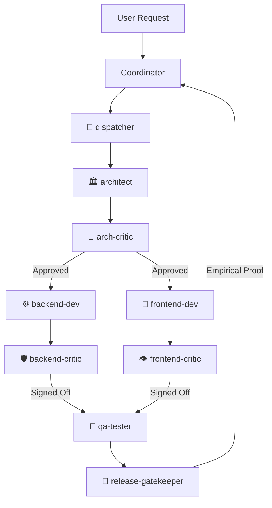

# Autonomous Software Company (9-Agent Engineering Squad)

An enterprise-grade autonomous software development system designed for AI coding environments. It structures development into **4 Builder-Critic tracks** coordinated by a **Task Dispatcher**, pairing each implementing agent with a dedicated reviewer to ensure zero-defect delivery.

---

## 1. Squad Roster & Visual Identity

| Track | Icon | Agent Name | Role | Core Responsibility |
|---|---|---|---|---|
| **Orchestration** | 🎯 | `dispatcher` | Task Dispatcher | Requirement breakdown, dependency planning, milestone tracking |
| **Architecture** | 🏛️ | `architect` | Lead Architect | System design, data models, contract specifications |
| | 🧐 | `arch-critic` | Architecture Critic | Structural review, scalability analysis, anti-pattern detection |
| **Backend** | ⚙️ | `backend-dev` | Backend Engineer | APIs, database migrations, security rules, server logic |
| | 🛡️ | `backend-critic` | Backend Critic | Security audit, OWASP vulnerability checks, query optimization, input validation |
| **Frontend** | 🎨 | `frontend-dev` | Frontend Engineer | Responsive interfaces (360px+), accessible components, styling |
| | 👁️ | `frontend-critic` | Frontend Critic | Interface auditing (`better-interface`), visual verification, mobile auditing, WCAG 2.1 AA |
| **Quality & Release** | 🧪 | `qa-tester` | QA Automation | End-to-end testing, integration suites, test-driven validation |
| | 🚀 | `release-gatekeeper` | Release Gatekeeper | Build integrity, empirical test verification, release sign-off |
| **Safety Net** | 📡 | `monitor` | Stall Monitor | Deadlock prevention and activity monitoring |

---

## 2. Peer-to-Peer Handoff Architecture



---

## 3. Engineering Foundations

The squad operates under established software engineering methodologies:
- **Karpathy Simplicity Principles:** Surface assumptions early, write minimum necessary code, make surgical changes without collateral refactoring.
- **Hashimoto Harness Pattern:** Automated test harnesses serve as the deterministic source of truth; git-backed rollback loops maintain repository hygiene.
- **Willison Defensive Security:** Strict boundary separation for untrusted input, parameterization for database queries, and defense against injection attacks.

---

## 4. Quickstart & Installation

### Windows Installation
Run the automated PowerShell installer:
```powershell
powershell -ExecutionPolicy Bypass -File .\install.ps1
```

### macOS / Linux Installation
Run the Bash installer:
```bash
chmod +x ./install.sh
./install.sh
```

---

## 5. Security & Zero Secret Leakage Policy

This repository enforces strict protection standards:
- Comprehensive `.gitignore` protecting against `.env` variations, certificate files, tokens, and local database artifacts.
- No personal credentials, session tokens, or private endpoints are included.
